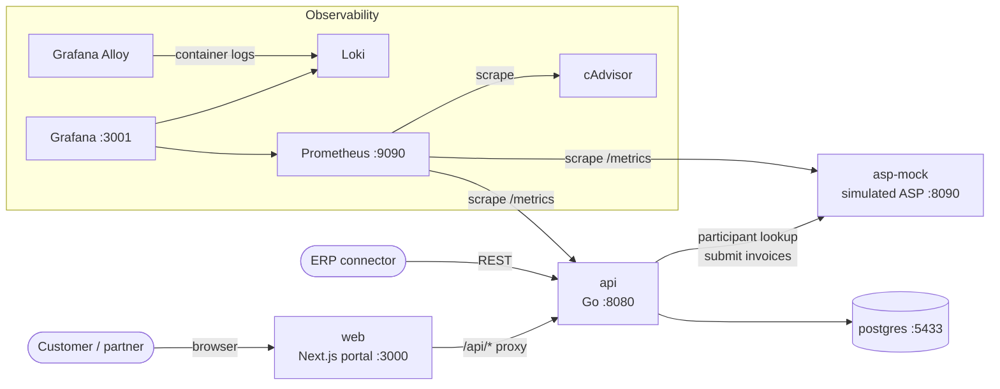

# Architecture

## UAE e-invoicing in one minute

In the UAE, the Federal Tax Authority (FTA) is introducing mandatory e-invoicing. Invoices are no longer emailed as PDFs: they are exchanged as structured data over the **Peppol** network. Peppol uses a "5-corner" model: the seller (corner 1) hands its invoice to its **Accredited Service Provider (ASP)** (corner 2), which delivers it to the buyer's ASP (corner 3) and on to the buyer (corner 4), while tax data is reported to the FTA (corner 5). The invoice format is **PINT AE**, the UAE flavour of the Peppol International invoice. Every seller and buyer has a 15-digit **TRN** (Tax Registration Number) and a **Peppol participant id** (in this lab: `0235:` followed by 10 digits).

Invoicely Lite sits in front of corner 2: customers upload an Excel file, the portal checks it, converts each invoice to PINT AE and submits it to the ASP. When the ASP accepts an invoice it returns a message id, shown in the portal as the **ASP reference**.

## Components

| Component | Code | Role |
|---|---|---|
| web | `web/` | Portal: upload page, batches, batch detail, invoice detail. Server-side proxy from `/api/*` to the api. |
| api | `services/api/` | REST API. Reads the workbook, maps rows to PINT AE invoices, validates them, stores them in Postgres and submits them to the ASP in the background. |
| asp-mock | `services/asp-mock/` | Simulated ASP. Validates and accepts or rejects each invoice. Keeps received documents in memory (cleared when it restarts). |
| postgres | `db/init/` | Sellers, imports (batches), invoices and the status history of each invoice. |
| Prometheus + cAdvisor | `observability/prometheus/` | Application metrics from api and asp-mock, container CPU / memory from cAdvisor. |
| Loki + Alloy | `observability/loki/`, `observability/alloy/` | Logs of every container, searchable in Grafana. |
| Grafana | `observability/grafana/` | Dashboard "Invoicely Lite – Overview", log search (Explore), alert rules. |

## How an upload flows

1. The customer chooses a company and uploads an `.xlsx` file (`POST /v1/imports`).
2. The api creates an import (batch), reads the `Invoices` sheet and groups rows by `Invoice number*`.
3. Each invoice is mapped to a PINT AE JSON payload and stored with status **Parsed**.
4. Each invoice is validated against the portal rules (see [template-field-guide.md](template-field-guide.md)). It becomes **Validated** or **Rejected** (by portal).
5. The upload request returns. Validated invoices are submitted to the ASP in the background: **Submitted**, then **Accepted** or **Rejected** (by ASP), or **Failed** if the ASP could not be reached.

Statuses are described in [status-lifecycle.md](status-lifecycle.md).

## ASP integration

The ASP publishes the following interface (implemented by `asp-mock`):

| Endpoint | Behaviour |
|---|---|
| `POST /v1/documents` | Submit **one** invoice (PINT AE JSON). The sender is identified by the `X-Sender-Id` header (the seller's Peppol id). Returns **200** `{"status":"accepted","messageId":"…"}` when accepted, **422** `{"status":"rejected","errors":[{"rule":"…","message":"…"}]}` when a business rule fails. |
| Fair-use limit | The ASP applies a per-sender rate limit. When it is exceeded it returns **HTTP 429** with a `Retry-After` header (seconds); the document has not been received and should be sent again later. |
| `GET /v1/participants/{peppolId}` | Peppol participant lookup: 200 if the participant is registered on the network, 404 if not. |
| `GET /v1/documents?sender=<peppolId>` | Lists the documents the ASP has received from a sender (accepted and rejected). |
| `GET /v1/documents/{messageId}` | One received document. |

Example: `curl "http://localhost:8090/v1/documents?sender=0235:1002345678"`.

## Where to look

| What | Where |
|---|---|
| Dashboard | Grafana http://localhost:3001 → "Invoicely Lite – Overview" (the home dashboard) |
| Logs | Grafana → Explore → Loki. Examples: `{service="api"} \| json`, `{service="api"} \| json \| level="error"`, `{service="asp-mock"} \| json`, `{service="web"}` |
| Alerts | Grafana → Alerting → Alert rules (folder "Invoicely") |
| Metrics | Prometheus http://localhost:9090 (try `invoicely_` in the query box), or Grafana → Explore → Prometheus. The api exposes them at http://localhost:8080/metrics |
| Database | `make psql`, then for example `\dt` and `SELECT status, count(*) FROM invoices GROUP BY status;` |
| Containers | `make ps`, `docker compose logs <service>`, `docker inspect <container>` |
| API | See the API table in [README.md](../README.md) |

All log lines from the api and asp-mock are JSON with `time`, `level` and `msg` fields.
