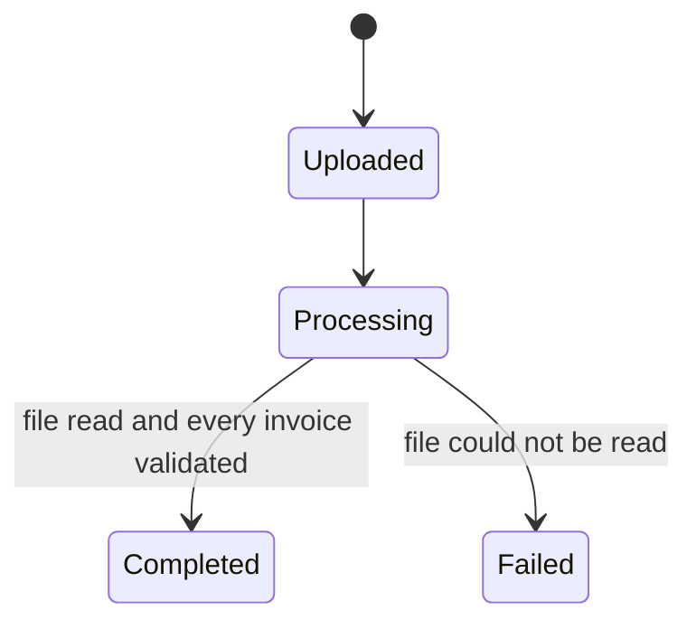
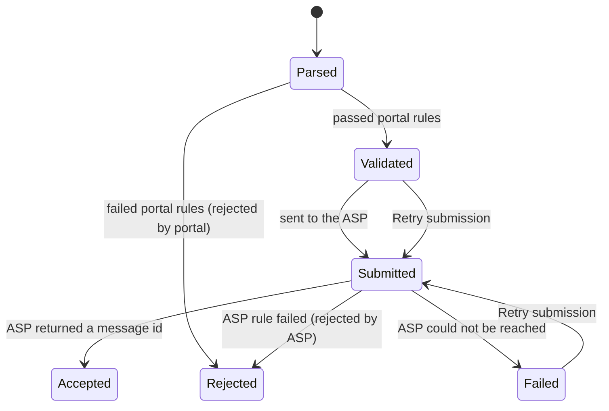

# Status lifecycle

## Import (batch)

One upload = one import. The batch list shows the import status and a count of invoices per status.

| Status | Meaning for the customer |
|---|---|
| Uploaded | File received. |
| Processing | The portal is reading and validating the file. The upload page shows "Processing your file…" during this time. |
| Completed | Every invoice in the file has been created and validated. Submission to the ASP continues in the background. |
| Failed | The file could not be read (not an `.xlsx`, or not the Invoicely template). Nothing was created. |

## Invoice

| Status | Meaning for the customer | What they can do |
|---|---|---|
| Parsed | Created from the file, not yet validated. Normally lasts seconds. | Wait. |
| Validated | Passed portal validation, waiting to be sent to the ASP. Normally lasts seconds. | If it stays here for more than 15 minutes, use **Retry submission**. |
| Submitted | Handed to the ASP, waiting for its answer. Normally lasts seconds. | Wait. |
| Accepted | The ASP accepted the invoice and returned a message id, shown as **ASP reference**. The invoice is on its way to the buyer. | Nothing. |
| Rejected — by portal | Failed one or more portal rules (AE-BR-xx). It was **not** sent to the ASP. | Correct the file and upload the corrected invoices again. |
| Rejected — by ASP | The ASP refused it (for example BR-CO-15). It did not reach the buyer. | Depends on the rule; see [template-field-guide.md](template-field-guide.md). |
| Failed | Could not be delivered (for example the ASP was unreachable). | **Retry submission**. |

Every status change is recorded in the invoice's **Status history** (invoice page) and in the `invoice_events` table.

## Retry submission

- **Retry submission** on the invoice page, or **Retry stuck invoices** on the batch page, sends invoices in status **Validated** or **Failed** to the ASP again.
- API: `POST /v1/invoices/{id}/retry` and `POST /v1/imports/{id}/retry`.
- Other statuses cannot be retried (`409`).

## Rejected invoices and invoice numbers

A rejected invoice does not "use up" its number: the customer can upload a corrected invoice with the same number. An invoice number that already exists in any other status gives AE-BR-09.
